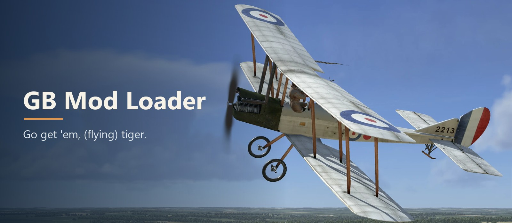

|download| |build| |platform| |license|

.. |download| image:: https://img.shields.io/badge/Download-latest-c98a4b?style=for-the-badge
   :target: https://github.com/Dusty926/GB-Mod-Loader-Releases/releases/latest
   :alt: Download the latest release
.. |build| image:: https://img.shields.io/badge/Game_build-20261004-2c4a5e?style=for-the-badge
   :alt: Game build 20261004
.. |platform| image:: https://img.shields.io/badge/Windows-64--bit-2c4a5e?style=for-the-badge
   :alt: Windows 64-bit
.. |license| image:: https://img.shields.io/badge/License-CC_BY--ND_4.0-2c4a5e?style=for-the-badge
   :target: LICENSE.txt
   :alt: License CC BY-ND 4.0

**A plugin mod loader for IL-2 Great Battles.** Drop mods into one folder and they load at the next
game start, with nothing to edit. If the game updates to a different build, the loader steps aside
and the game runs normally.

----

📦 What it does
---------------

.. list-table::
   :widths: 30 70

   * - 🔌 **Loads plugins**
     - Finds every plugin in one folder and starts it with the game
   * - 🛡️ **Checks the game build**
     - Only runs on the exact build it was made for
   * - 🌐 **Matches players**
     - In multiplayer, you only play with players whose loader and mods match yours

This download is the loader itself. Plugins are released separately, with the mods that need them.

🚀 Install
----------

1. **Close the game.**
2. **Download** the zip from the `Releases page <https://github.com/Dusty926/GB-Mod-Loader-Releases/releases/latest>`_ and unzip it.
3. **Copy** the contents of its ``bin\game`` folder into the game's ``bin\game`` folder.
4. **Turn Mods ON** in the game.
5. **Start the game** and open ``bin\game\gbml_log.txt`` to see what loaded.

🧩 Adding and removing plugins
------------------------------

- **Add one:** put its ``.dll`` and ``.ini`` in ``bin\game\gbml``. It loads at the next game start.
- **Switch one off:** set its line to ``name=0`` under ``[plugins]`` in ``gbml.ini``.

🌐 Multiplayer
--------------

Mods ON keeps you off normal multiplayer servers. With the loader, you only play with players whose
loader and mods match yours.

🧹 Uninstall
------------

Delete ``winmm.dll``, ``GBML.dll``, ``gbml.ini``, ``gbml_log.txt``, ``gbml_log.old.txt`` and the ``gbml`` folder
from ``bin\game``.

🛠️ Writing plugins
------------------

Build a 64-bit DLL against `sdk/gbml.h <sdk/gbml.h>`_. Instructions are in that file. It's MIT
licensed, so you can share your plugin under whatever terms you like.

📄 License
----------

The plugin header is **MIT**. Everything else is **CC BY-ND 4.0**: use and share unmodified copies
with credit, and ask before distributing changed versions. See `LICENSE.txt <LICENSE.txt>`_.

IL-2 Great Battles and its files belong to their owners. This project is not affiliated with them.
